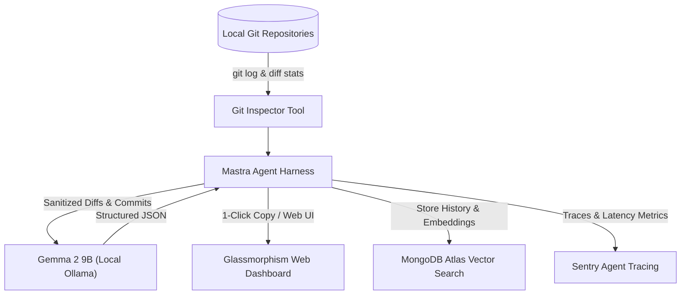

# TurtleShell 🐢
> **The Slow & Steady Git Janitor**  
> An offline background agent that turns chaotic git commits into executive standups and release notes while you sleep.

[](https://dev.to/t/hf26challenge)
[](LICENSE)
[](https://ollama.com/library/gemma2)
[](https://www.mongodb.com/atlas)
[](https://sentry.io)

---

## 💡 The Problem
Every morning before standup, developers stare at blank Slack messages trying to remember what they worked on yesterday. Your git history looks like:
```text
7fa281a tests pass please merge
189d023 it works now finally
3b190c4 fix typo in readme
8a291f0 wip: playing with css glassmorphism colors
0d912ba wait forgot file
```
Reconstructing real feature progress from this chaos takes 20–30 minutes of cognitive drudgery every morning.

## 🐢 The Turtle Solution
In honor of Aesop’s tortoise—who proved that slow, steady, and unhurried beats frantic rushing every time—**TurtleShell** runs quietly in the background:
1. Inspects your local git commits, stats, and diffs across repositories.
2. Filters out noisy lockfiles (`package-lock.json`, `pnpm-lock.yaml`) and generated assets.
3. Uses a **local open-weight Gemma 2 9B model** to synthesize feature progress into:
   - **Daily Standup**: Formatted for Slack/Discord (`Yesterday`, `Today`, `Blockers`).
   - **Conventional Changelog**: Grouped into Features, Fixes, and Chores.
4. Saves past standups into **MongoDB Atlas** for natural language semantic memory search (*"What did I do on auth last week?"*).
5. Traces all agent steps and latencies using **Sentry Agent Tracing**.

---

## 🛠️ Free-Tier Architecture

TurtleShell is designed around **100% free and open-source tools**:

| Component | Technology | Free Tier Guarantee |
| :--- | :--- | :--- |
| **Code Intelligence** | **Gemma 2 9B** (via Ollama) | Open-weight model running locally on-device ($0 API cost, 100% privacy). |
| **Agent Framework** | **Mastra** (`@mastra/core`) | Open-source TypeScript agent orchestration. |
| **Long-Term Memory** | **MongoDB Atlas** | Free M0 sandbox cluster for history & vector search. |
| **Observability** | **Sentry** (`@sentry/node`) | Tracing agent spans, tool calls, and LLM inference latencies. |



---

## 🚀 Quick Start

### 1. Prerequisites
- **Node.js** v20+
- **Ollama** installed with Gemma 2 9B:
  ```bash
  ollama pull gemma2:9b
  ```

### 2. Installation
```bash
git clone https://github.com/DaKaufeeBoii/turtle-shell.git
cd turtle-shell/backend
npm install
```

### 3. Environment Configuration
Copy the sample environment file:
```bash
cp .env.example .env
```
Add your optional credentials (falls back to local JSON history if MongoDB is omitted):
```env
PORT=3456
OLLAMA_HOST=http://127.0.0.1:11434
OLLAMA_MODEL=gemma2:9b

# MongoDB Atlas (Optional)
MONGODB_URI=mongodb+srv://<username>:<password>@your-cluster.mongodb.net/?retryWrites=true&w=majority
MONGODB_DB_NAME=shellturtle

# Sentry Agent Tracing (Optional)
SENTRY_DSN=https://your-key@oXXXX.ingest.sentry.io/XXXX
```

### 4. Run TurtleShell

#### Option A: Web Dashboard
```bash
npm run dev
```
Open **`http://localhost:3456`** to use the interactive dark-mode dashboard with:
- 1-click **Copy to Slack**
- **Chaos vs. Order** commit comparison
- **Turtle Memory Search** over past standups

#### Option B: Terminal CLI (Instant)
```bash
npm run turtle
```
Generates your daily standup directly in your terminal and **automatically copies it to your clipboard**.

---

## 🔒 Privacy & Open Innovation

Git diffs frequently contain sensitive internal URLs, proprietary code, or confidential feature plans. Because TurtleShell uses **Gemma 2 9B running locally via Ollama**, not a single byte of your codebase leaves your machine. 

Set it up once, pay $0 forever, and let the tortoise do the paperwork while you sleep.

---

## 📜 License
MIT License. Built for the **Hacktoberfest 2026 Open-Source AI Challenge: Week 3 (Slow and Steady)**.
